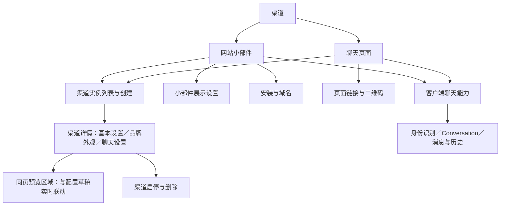
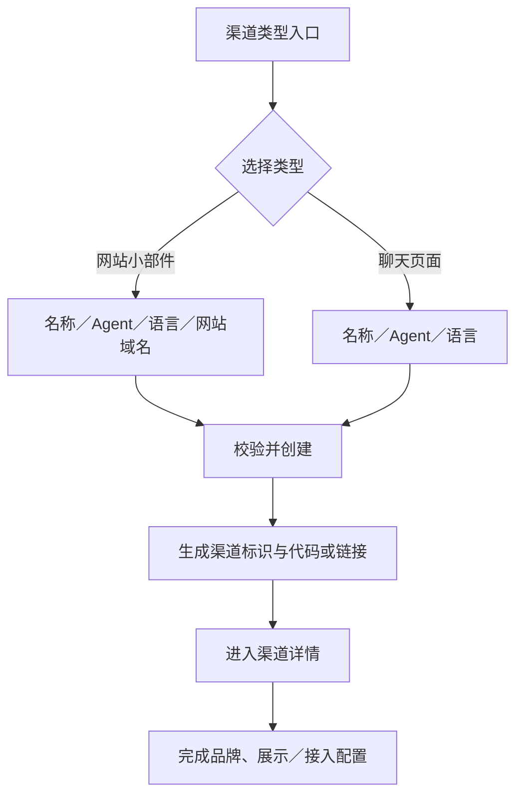
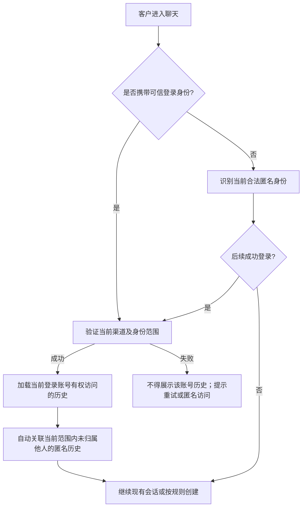
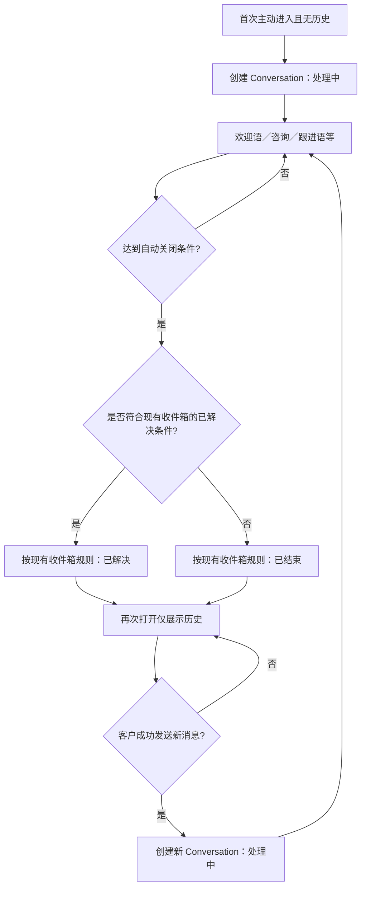
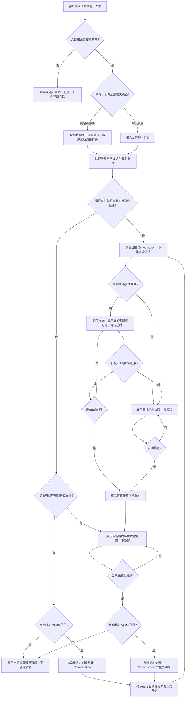

# AI Agent 工作台｜网站小部件与聊天页面需求文档（V1.0）

| 文档信息 | 内容                                     |
| ---- | -------------------------------------- |
| 产品   | AI Agent 工作台                           |
| 所属模块 | 渠道                                     |
| 需求名称 | 新增网站小部件（Web Widget）与聊天页面（Chat Page）渠道  |
| 文档类型 | 产品需求文档（PRD）                            |
| 版本   | V1.0（开发评审定稿）                           |
| 更新日期 | 2026-10-13                             |
| 文档状态 | 产品规则、字段默认值及交互已确认；技术实现须满足本文确定的行为与安全验收要求 |

> **阅读约定**：本文是一份完整 PRD，两个渠道的专属功能分别定义，共用功能只定义一次；“客户”指聊天终端使用者，“管理员”指有权限的工作台用户；“Conversation”指后台独立会话记录。通用组件与字段校验直接执行既有工作台统一规范；身份凭证、安全检查等由研发选择实现方式，但必须满足本文确定的行为、权限与验收标准。

## 1. 需求概述

### 1.1 背景与目标

现有【渠道】模块需支持两种新的 AI Agent 对客入口：

1. **网站小部件（Web Widget）**：企业将渠道专属代码安装在网站，客户通过网页悬浮按钮打开聊天窗口，不离开当前网页。
2. **聊天页面（Chat Page）**：平台为渠道生成独立、固定的聊天 URL 和二维码，客户在 PC 或移动端打开全屏聊天页面。

两种渠道独立创建、配置、启停和删除；复用现有 AI Agent 的知识库、工作流、欢迎语、跟进语、结束语和客服会话能力。

**目标**：完成渠道配置与接入、品牌及界面展示、匿名与可信登录身份识别、客户消息和连续历史、Conversation 生命周期、安装检测、可交互预览及可追溯的会话数据记录。**本次不新增 Dashboard、数据统计页面或 AI 解决判定能力**。

### 1.2 业务范围与约束

- 一个渠道**只能绑定一个 AI Agent**；一个 AI Agent 可被多个渠道绑定。
- 一个网站小部件渠道可安装在多个网站，共用 Agent 和渠道配置；**不同网站身份范围的客户与聊天历史隔离**。
- 一个聊天页面渠道对应一个业务平台使用场景；不同独立游戏平台使用各自的聊天页面渠道，不通过一个公开链接混合多个平台的已登录身份。
- 客户端只有一个连续消息流；后台仍按多个独立 Conversation 存储、状态管理及统计。
- 本需求**不新增转人工配置**；Conversation 的「已解决」定义和识别机制**直接继承现有【收件箱】规则**，不重新设计判定标准。
- 当前工作台没有 Dashboard；本次不新增 Dashboard 或报表页面。历史会话的统计口径作为数据记录规则保留，供既有模块或后续统计使用。
- V1.0 不引入营销欢迎首页、复杂展示条件、独立身份管理中心、跨网站身份合并、自定义聊天页面域名或手动关闭 Conversation。

### 1.3 角色与术语

| 术语           | 定义                                                     |
| ------------ | ------------------------------------------------------ |
| 渠道           | AI Agent 对客接入实例，类型为网站小部件或聊天页面，拥有独立配置、链接/代码及状态          |
| 网站身份范围       | 网站小部件客户历史的隔离边界：主域名与其 `www` 为同一范围；其他子域名及其他主域名各自独立       |
| 匿名客户         | 未提供有效登录身份、凭浏览器访客标识识别的客户                                |
| 已登录客户        | 经接入业务平台身份凭证校验通过的客户                                     |
| Conversation | 一次独立会话记录；首次主动进入或已关闭后发送新消息时创建，按超时规则自动关闭                 |
| 有效客户消息       | 成功发送并被系统接受的客户文本/附件消息；不包括上传暂存、失败消息、AI 消息和系统消息           |
| 预览会话         | 管理后台【预览】中直接发送消息时建立的隔离会话，仅用于验证 AI 对话效果，不进入正式收件箱、客户列表及统计 |

## 2. 功能架构与页面结构

### 2.1 功能结构

### 2.2 页面清单

| 页面或区域          | 主要内容                                | 适用类型  |
| -------------- | ----------------------------------- | ----- |
| 渠道类型入口         | 类型卡片、创建、进入管理                        | 两种类型  |
| 渠道实例列表         | 搜索、状态/Agent 筛选、实例列表、启停与删除入口         | 两种类型  |
| 创建渠道           | 名称、Agent、语言；小部件额外需网站域名              | 两种类型  |
| 渠道详情 · 基本设置    | 渠道名称、接待 Agent、界面语言、只读状态与类型          | 两种类型  |
| 渠道详情 · 品牌外观    | 品牌名称、Logo、签名、主题颜色                   | 两种类型  |
| 渠道详情 · 小部件显示设置 | 图标、位置、边距、PC/移动端可见性                  | 网站小部件 |
| 渠道详情 · 安装与域名   | 主网站、允许域名、安装代码、安装记录与检测               | 网站小部件 |
| 渠道详情 · 页面链接    | URL、复制、打开、二维码预览与下载                  | 聊天页面  |
| 渠道详情 · 聊天设置    | 新消息提示音的渠道默认值                        | 两种类型  |
| 渠道详情 · 预览区域    | 与配置区同页联动；标题「预览」、PC/移动端、可交互聊天及清空预览会话 | 两种类型  |
| 客户端聊天界面        | 品牌顶部、连续消息流、输入和附件、未读提示               | 两种类型  |

后台视觉、权限、时间显示、列表组件、提示样式与已有渠道管理保持一致。不同渠道特有模块按类型展示，不以禁用态混排无关设置。

## 3. 渠道创建与管理

### 3.1 【渠道类型】入口

页面路径：【渠道】→ 对应类型卡片 →【管理】或【创建渠道】。

| 元素   | 内容                          | 操作               |
| ---- | --------------------------- | ---------------- |
| 类型卡片 | 网站小部件 / 聊天页面：图标、名称及一句使用场景说明 | 点击管理进入该类型实例列表    |
| 创建渠道 | 当前类型的创建入口                   | 打开创建表单，类型预选且不可编辑 |
| 管理   | 当前类型列表入口                    | 展示此类型已创建渠道       |

新增渠道类型与现有 LiveChat、TG 同级，不改变原渠道入口及规则。

### 3.2 【渠道实例列表】字段与操作

| 字段/控件       | 显示/默认值        | 操作规则                                              |
| ----------- | ------------- | ------------------------------------------------- |
| 渠道名称        | 后台自定义名称       | 点击进入详情；过长省略，悬浮显示全称                                |
| 渠道类型        | 网站小部件 / 聊天页面  | 单类型列表可省略，总列表需显示                                   |
| 接待 AI Agent | 当前绑定 Agent 名称 | Agent 已停用时显示其不可用状态                                |
| 渠道状态        | 启用 / 停用       | 与详情状态实时一致                                         |
| 创建时间        | 创建时间戳         | 沿用工作台时区与格式                                        |
| 搜索          | 默认空           | 按渠道名称搜索；清空恢复全部                                    |
| 状态筛选        | 默认全部          | 全部／启用／停用                                          |
| AI Agent 筛选 | 默认「全部」        | 支持搜索并单选 AI Agent；按**当前绑定**该 Agent 的渠道实例过滤；清空后恢复全部 |
| 新建渠道        | 主操作按钮         | 进入当前类型的创建表单                                       |
| 管理 / 编辑     | 行操作           | 进入详情，默认打开基本设置                                     |
| 启用 / 停用     | 随状态显示其一       | 见 3.6 状态规则                                        |
| 删除          | 仅停用渠道可操作      | 见 3.6 删除规则；启用状态不直接删除                              |

空列表展示渠道类型说明及创建入口；搜索无结果提供清空筛选；加载失败保留查询条件并可重试。列表默认按**创建时间倒序**（最新创建在前），每页 **20 条**，支持翻页；翻页保留搜索和筛选条件，条件变更后从第一页展示。列表仅对有权限管理员展示相应操作。

### 3.3 【创建渠道】字段与交互

| 字段          | 控件      | 必填      | 默认值          | 规则                                                            |
| ----------- | ------- | ------- | ------------ | ------------------------------------------------------------- |
| 渠道类型        | 只读      | 是       | 创建入口对应类型     | 创建后不可更改                                                       |
| 渠道名称        | 单行输入框   | 是       | 空            | 去首尾空格后不可为空；长度、字符校验与重名范围**沿用现有渠道名称字段统一规范**                     |
| 接待 AI Agent | 可搜索单选下拉 | 是       | 未选择          | 仅可选可用 Agent；不能选已停用/已删除对象                                      |
| 界面语言        | 单选下拉    | 是       | **自动（Auto）** | 选项为「自动（Auto）」和工作台已支持的固定语言；单选必填；仅控制客户端 UI 文案，不改变 AI Agent 回复语言 |
| 网站域名        | 单行输入    | 网站小部件必填 | 空            | 填写主要网站域名，如 `game-a.com`；不能是路径、参数或通配符                          |
| 创建渠道        | 主按钮     | —       | 可操作          | 校验全部字段；提交时防重复创建                                               |
| 取消          | 次按钮     | —       | —            | 返回来源页面；存在未保存输入时确认是否放弃                                         |

**界面语言识别规则**：选择「自动」时，网站小部件按「当前网站界面语言 → 浏览器语言 → **English**」依次匹配工作台支持的语言；聊天页面按「浏览器语言 → **English**」匹配。某一级语言无法识别或不属于已支持语言时顺次回退；选择任意固定语言时始终使用该语言，不执行自动识别。语言只作用于客户端按钮、输入提示、系统文案等 UI 内容，与 Agent 回复语言配置独立。

**输入校验**：空名称、无 Agent、无语言、无效域名不允许提交并定位错误；粘贴 `https://game-a.com/` 时可规范化为主机名并回显，无法可靠规范化时提示。`*.game-a.com`、`game-a.com/deposit` 不是合法的主网站域名值。重复渠道名称处理沿用现有渠道规则，不额外假定全局唯一。

**创建操作**：

1. 选择渠道类型并填表，点击【创建渠道】；保存中按钮禁用，失败保留输入并提示原因。
2. 成功生成唯一渠道标识；网站小部件生成专属嵌入代码、将主域名自动加入允许域名列表；聊天页面生成固定的公开 URL。
3. 跳转详情并提示「渠道创建成功」，默认状态为「启用」，引导继续配置品牌和接入方式。
4. **渠道创建成功后默认「启用」**，在详情页及渠道列表立即展示「启用」状态；网站小部件须实际安装并满足域名授权才会出现入口，聊天页面的公开 URL 创建成功后即可访问。管理员可按 3.6 手动停用。

### 3.4 【渠道详情】通用结构与保存

顶部展示面包屑、渠道名称、类型、启停状态及当前接待 Agent；操作区为【启用/停用】和【删除】。内容按 2.2 页面清单提供分组导航。**渠道详情采用配置区与「预览」区同页联动布局**：PC 端左侧配置、右侧持续显示预览；窄屏时上下排列。管理员切换基本设置、品牌外观、小部件显示设置及聊天设置等配置分组时，无需跳转独立预览页，预览区域保持可见。

- 每组独立编辑、独立【保存】【取消】；未更改时不提供无意义提交。预览实时读取当前未保存的外观／显示草稿，但真实渠道仍使用上一次已保存的配置。
- 取消仅撤销当前分组草稿；保存成功提示「保存成功」，保存失败保留草稿并提供重试。保存或取消某分组时，不覆盖其他分组尚未保存的草稿。
- 必填或格式错误时阻止保存并在相应字段旁提示；保存中避免重复提交。
- **切换配置分组时**，保留所有分组已编辑但未保存的草稿及当前预览会话，不弹出离开页面确认；各分组保留未保存标识。**离开当前渠道详情、返回列表、切换其他渠道或刷新页面时**，如仍有未保存内容，提示【放弃修改／继续编辑】。
- 多人同时修改：提交时校验后台最新状态及引用关系；冲突时提示刷新确认，不静默覆盖其他管理员修改。
- 修改名称、品牌、语言、显示或提示音配置不改变渠道标识、安装代码、聊天链接和已存 Conversation；客户端重新加载后应用新配置，不强制清空已打开窗口。

#### 基本设置字段

| 字段          | 控件    | 规则与保存结果                                                                                                                |
| ----------- | ----- | ---------------------------------------------------------------------------------------------------------------------- |
| 渠道名称        | 单行输入  | 必填；校验同 3.3；更新列表和详情，不改历史渠道归属标识                                                                                          |
| 接待 AI Agent | 可搜索单选 | 必填，仅可选可用 Agent；更换前提示「仅对新 Conversation 生效」，已在处理中的仍属原 Agent                                                              |
| 界面语言        | 单选下拉  | 必填，默认「自动」；选项包含「自动」和已支持的固定语言；自动时网站小部件依次匹配网站语言、浏览器语言、English，聊天页面依次匹配浏览器语言、English；固定语言优先于自动识别；保存后新加载界面生效，不改变 Agent 回复语言 |
| 渠道类型        | 只读    | 不可变更                                                                                                                   |
| 渠道状态        | 只读    | 通过顶部启停操作变更                                                                                                             |

更换 Agent 后，历史及处理中 Conversation 的实际接待 Agent 不改写。保存时若新 Agent 已停用或不存在，则拒绝切换并显示错误。

#### 聊天设置字段

| 字段     | 控件   | 默认值 | 操作与规则                                  |
| ------ | ---- | --- | -------------------------------------- |
| 新消息提示音 | 开关   | 开启  | 定义当前渠道首次使用客户的默认提示音设置，客户自主选择优先；按组保存     |
| 提示音说明  | 辅助文案 | —   | 仅新收到的 AI 消息发声，读取历史与自己发送不发声；遵守浏览器自动播放限制 |

### 3.5 【预览】区域与交互

渠道详情中的预览区域标题统一&#x4E3A;**「预览」**，与配置表单**同页显示且实时联动**，不是必须先跳转进入的独立页面。管理员既可查看最终外观，也可直接在聊天输入框内验证 AI Agent 回复；不设置【开始测试】按钮、模式切换或常驻「测试模式」标签。

| 页面元素        | 网站小部件                   | 聊天页面                  | 操作规则                                                             |
| ----------- | ----------------------- | --------------------- | ---------------------------------------------------------------- |
| 预览区标题       | 「预览」                    | 「预览」                  | 不附加渠道名称或「测试模式」等字样；PC 端与左侧配置区并排，窄屏上下排列                            |
| 设备切换        | PC／移动端                  | PC／移动端                | 默认 PC；仅改变模拟视口，不修改真实设备显示开关，也不重建已有预览会话                             |
| 预览背景        | **透明棋盘格**（浅灰／白交错网格）     | 对应设备尺寸的全屏聊天页面         | 小部件只在棋盘格内模拟悬浮效果，不绘制假网站页面、不代表实际安装状态                               |
| 悬浮按钮        | 反映配置图标、主题色、位置与边距        | 不适用                   | 点击展开／收起窗口；首次展开时初始化隔离预览会话，并按 Agent 已有欢迎语规则显示欢迎语                   |
| 聊天页面初始化     | 不适用                     | 打开当前聊天页面预览视图时进入可用聊天界面 | 如没有已有预览会话，按新会话规则初始化隔离预览会话并显示已配置的欢迎语                              |
| 聊天窗口和品牌信息   | 可展开／收起的实际小部件样式          | 全屏聊天样式                | Logo、品牌名称、签名、主题色、消息气泡等与客户端一致                                     |
| 配置草稿联动      | 实时读取当前表单草稿              | 同左                    | 品牌和显示配置的未保存修改立刻反映在右侧预览；只有点击对应分组【保存】后才对真实客户生效                     |
| 消息输入与发送     | 展开窗口后直接使用输入框            | 直接使用页面输入框             | 支持文本、Emoji、合规附件；进入预览会话后直接发送，无需额外点击按钮                             |
| AI Agent 回复 | 使用当前**已保存绑定且可用**的 Agent | 同左                    | 允许回复与安全只读查询；尚未保存的新 Agent 选择不提前改变预览中的实际接待者                        |
| 清空预览会话      | 按钮                      | 按钮                    | 清除当前预览消息并恢复初始预览状态：小部件下次展开重新初始化；聊天页面重新进入初始聊天视图并按新会话规则展示欢迎语        |
| 停用状态        | 渠道停用时仍可预览外观和对话          | 同左                    | **渠道停用不影响后台预览**；绑定 Agent 有效时仍可预览对话；Agent 已停用则展示「当前客服暂不可用」并禁用预览发送 |

**交互及数据规则**：

1. **外观草稿与会话独立**：切换配置分组、设备视图，或收起／重开展示已初始化的预览聊天，不会重复触发欢迎语或清空对话；未保存的外观修改不影响真实渠道。切换其他渠道或保存更换绑定 Agent 后，不能继续沿用原 Agent 的预览会话，应重新初始化对应渠道／Agent 的隔离预览上下文。
2. **模拟正式首次进入行为**：小部件首次主动展开时、聊天页面首次进入可用预览视图时，分别初始化隔离的预览 Conversation；若 Agent 已配置欢迎语则按其规则显示。仅加载小部件悬浮按钮而未展开，不初始化预览会话。正式会话的「重新进入不重复欢迎语」规则在预览中同样成立。
3. **允许直接聊天**：管理员可直接发送消息；外观预览、切换设备、发送预览消息均不得创建正式客户 Conversation。预览消息、客户身份和统计数据完全隔离，不进入正式【收件箱】、客户列表或统计。
4. **真实操作隔离**：可查询知识库或执行安全的只读操作；涉及发放奖励、修改订单、真实资金或账户变更时必须模拟或阻断。不能模拟的操作在对话结果中提示「预览中不执行该业务操作」，不得虚报真实执行成功；不显示常驻测试标签。
5. **可用性**：渠道自身停用时仍可预览，只要其当前绑定 Agent 可用就允许对话；绑定 Agent 已停用或无效时，预览保留外观展示，输入禁用并提示「当前客服暂不可用」，不发送欢迎语或其他 AI 消息。恢复有效绑定 Agent 后可重新进行预览对话。
6. 【清空预览会话】不影响保存的渠道配置、正式 Conversation、正式客户消息或真实业务数据。清空后的欢迎语仅属于隔离预览记录，不触发正式客服接待。

### 3.6 【启停、删除】交互与生命周期

| 当前状态 | 允许操作                     | 约束                                     |
| ---- | ------------------------ | -------------------------------------- |
| 启用   | 编辑、查看、预览、检测、复制接入信息、停用    | 不提供直接删除入口；删除前必须停用                      |
| 停用   | 编辑、查看、预览、检测、复制接入信息、启用、删除 | 真实客户端不能继续收发消息；绑定 Agent 可用时仍可在后台预览中直接对话 |
| 已删除  | 仅按原有权限查询历史记录             | 常规渠道实例列表不再提供管理操作                       |

**停用确认弹窗**：标题「停用渠道？」；说明「停用后将立即停止接待和正在生成的 AI 回复；已有 Conversation 按原超时规则关闭；停用不会额外删除历史消息，仍执行 6 个月保留期」；按钮【取消】【确认停用】。成功后更新状态。

**启用**：点击后验证当前绑定 Agent 可用，Agent 无效则阻止并提示先更换。成功恢复原代码/URL，不补发停用期间未发送成功的 AI 消息；原会话是否可继续由 **7.4、7.5 节**定义。

**删除确认弹窗**：仅停用渠道可删除；标题「删除渠道？」；说明「删除后安装代码/聊天链接永久失效且无法恢复；历史 Conversation 的必要元数据、客户归属及统计数据保留；消息和附件遵循 6 个月保留期」；按钮【取消】【删除渠道】。成功移出常规渠道列表，失败保留现状并提示；删除操作不因重复请求删除其他资源。

**Agent 关联规则**：停用 Agent 会停止它正在处理的会话的后续回复，该会话客户端暂停发送并提示「当前客服暂不可用」，仍等待原超时关闭；渠道改绑其他 Agent 不使旧 Conversation 自动切换。**若新客户进入时渠道当前绑定 Agent 已停用，则入口展示「当前客服暂不可用」，禁止输入并且不创建无法接待的新 Conversation。**&#x5220;除 Agent 前如仍绑定渠道或有处理中 Conversation，则阻止删除。仅保留已结束历史时，可删除 Agent，但须保留历史实际接待归属。不同管理员并发操作时重新校验状态。

## 4. 网站小部件（Web Widget）专属需求

### 4.1 【品牌外观】（与聊天页面共用字段）

| 字段      | 控件             | 必填 | 默认值           | 操作／校验                                                                            |
| ------- | -------------- | -- | ------------- | -------------------------------------------------------------------------------- |
| 品牌名称    | 单行输入           | 是  | 创建时取渠道名称      | 聊天顶部主标题；长度、字符校验沿用工作台已有品牌名称同类字段规范；不可为空；编辑时实时预览                                    |
| 品牌 Logo | 图片上传           | 否  | 系统默认头像        | 上传后预览、可更换/移除；格式、文件大小、分辨率与已有 Logo 上传字段保持一致；非法文件提示                                 |
| 签名      | 单行或短文本         | 否  | 空             | 品牌名称下方的描述文案；长度与工作台已有同类描述字段保持一致；为空时整行不显示                                          |
| 主题颜色    | 颜色选择器 + HEX 输入 | 是  | **`#1c1f26`** | 两种渠道默认一致，单渠道独立修改；仅允许合法 6 位 HEX 色值（如 `#1c1f26`），修改后实时预览，点击【保存】后生效；前景文字和图标按对比度自动适配 |

品牌展示顺序为 Logo、品牌名称、签名；设置在每个**渠道实例**中独立保存，互不覆盖。Logo、渠道名称、品牌名称等与已有工作台同类字段采用**统一限制与错误文案**，本 PRD 不再额外定义另一套文件大小或字数标准。本节字段在聊天页面也适用，其专属容器布局见第 5 章。

**主题颜色应用规范（网站小部件和聊天页面共用）**：默认主题色均为 **`#1c1f26`**，管理员可分别修改各自渠道的主题色；网站小部件额外将主题色用于悬浮按钮。

| 客户端界面元素         | 是否应用主题色  | 显示规则                                              |
| --------------- | -------- | ------------------------------------------------- |
| 网站小部件悬浮按钮背景     | 是，仅网站小部件 | 按当前渠道主题色显示；入口图标自动采用具有可读对比度的颜色                     |
| 聊天窗口／聊天页面顶部背景   | 是        | 顶部品牌区域使用主题色；品牌名称、签名和操作图标自动选择清晰可读的前景色；Logo 图片本身不染色 |
| 客户发送的消息气泡       | 是        | 背景使用主题色，气泡文字自动选择可读的浅色或深色                          |
| 发送按钮背景          | 是        | 可发送状态使用主题色，按钮图标保持可读；禁用状态使用系统统一禁用样式                |
| 选中状态与主要强调控件     | 是        | 例如已选中的交互项、主要操作强调色；不覆盖错误、警告、成功等语义状态色               |
| AI Agent 消息气泡   | 否        | 使用系统统一浅色或中性色，不随主题色更改                              |
| 聊天消息区背景、普通输入框背景 | 否        | 使用聊天组件既有中性色方案                                     |
| 错误、警告、成功状态      | 否        | 始终使用系统语义状态色，不受主题色覆盖                               |

**可读性及预览**：普通文字与背景对比度不低于 **4.5:1**，重要交互图标与背景对比度不低于 **3:1**；自动选择前景颜色，不擅自改变管理员保存的主题色。变更颜色时 PC/移动端及两种渠道对应界面实时预览，只有保存后对外生效；本模块**不提供整组「恢复默认外观」操作**。

### 4.2 【显示设置】页面字段

| 字段       | 字段定义                          | 控件             | 必填 | 默认值      | 取值范围及交互校验                                                                         |
| -------- | ----------------------------- | -------------- | -- | -------- | --------------------------------------------------------------------------------- |
| 悬浮按钮图标   | 控制网站小部件收起时展示的入口图标             | 图标选择/安全图片上传    | 否  | 系统聊天图标   | 可更换或移除自定义图标；移除后显示系统聊天图标，预览随草稿更新；图片格式大小与 Logo 上传规范一致                               |
| 悬浮位置     | 控制悬浮按钮停靠在网页左下角或右下角            | 单选             | 是  | 右下角      | 左下角、右下角；切换后同步更新预览，保存后对客户端生效                                                       |
| 水平边距     | 悬浮按钮**外边缘**距离网页对应左侧/右侧边缘的水平距离 | 数字输入/步进器，单位 px | 是  | **24px** | **0～100px，整数，含上下限**；选左下角时从左侧计算，选右下角时从右侧计算；为空、负数、小数或超过 100 时不允许保存                  |
| 底部边距     | 悬浮按钮**外边缘**距离网页底部边缘的垂直距离      | 数字输入/步进器，单位 px | 是  | **24px** | **0～100px，整数，含上下限**；为空、负数、小数或超过 100 时不允许保存                                        |
| PC 端显示   | 是否在宽度 **≥768px** 的浏览器视口展示悬浮入口 | 开关             | 是  | 开启       | 关闭时隐藏对应宽度下的悬浮入口，不改变渠道启用状态                                                         |
| 移动端显示    | 是否在宽度 **<768px** 的浏览器视口展示悬浮入口 | 开关             | 是  | 开启       | 关闭时隐藏对应宽度下的悬浮入口，不改变渠道启用状态                                                         |
| PC/移动端预览 | 在配置同页的「预览」区域查看两种视口下的悬浮位置与聊天窗口 | 切换视图           | —  | PC       | 在**透明棋盘格背景**上模拟按钮及聊天窗口，随当前编辑草稿实时更新；首次展开按现有 Agent 欢迎语规则初始化隔离会话，随后可直接输入聊天；不修改正式渠道配置 |

**预览呈现**：小部件显示设置与第 3.5 节【预览】区域同页联动。预览区以透明棋盘格为背景，呈现悬浮按钮与展开后的聊天效果；管理员直接在窗口输入框中对话。切换设置分组时保留配置草稿及预览会话，不需另行跳转预览页。

**边距与设备定义**：水平边距和底部边距只控制**收起状态的悬浮按钮**，不设置展开后聊天窗口的宽高。以浏览器**视口宽度**区分展示规则：**小于 768px 为移动端，768px 及以上为 PC 端**，不依赖 User-Agent 推断设备。两端共用同一套边距配置，单位为 CSS 像素（px），左下角/右下角分别以对应侧边为基准。移动端需额外考虑刘海屏、底部手势区域等安全区域，确保按钮可点击；安全区域适配不得改写管理员保存的边距数值。

**操作规则**：

1. 初次创建时水平边距与底部边距均为 **24px**，悬浮位置默认**右下角**。修改任意数值或位置后，PC/移动端预览即时按草稿更新；只有点击【保存】后才对外生效，【取消】恢复已保存值。
2. 输入框只接受 **0～100 的整数**（0、100 均有效）。输入空值、负数、小数、非数字或超过 100 时，在对应字段显示「请输入 0～100 之间的整数」，禁止保存；保存失败则保留已输入内容以便修正或重试。
3. 位置切换时只改变水平边距的计算方向，不自动重置水平边距或底部边距。修改边距不会影响渠道标识、嵌入代码、允许域名、客户身份或 Conversation。
4. 两个显示开关可以**同时关闭**；保存时非阻断提示「所有设备均已隐藏小部件，渠道仍处于启用状态」。
5. 显示关闭不等于渠道停用：不强制结束已有 Conversation，也不修改允许域名或代码。
6. 点击悬浮入口直接展开聊天，不设置 Messenger 首页/先导页；展开与收起不触发会话结束。
7. 聊天窗口根据屏幕大小响应式调整；V1.0 不提供自定义聊天窗宽高配置；移动端布局适配需确保按钮与窗口入口可操作。
8. 新加载的网站页面按最新配置显示；打开的聊天窗口不强制因管理后台配置更新而重置。

### 4.3 【安装与域名】字段

| 元素 | 类型/初始值 | 规则与操作 |
|---|---|---|
| 网站域名 | 必填输入，创建时填写 | 记录主要网站；可修改；不含路径、参数、通配符 |
| 允许域名列表 | 初始自动包含网站域名 | 该列表是完整授权白名单；可新增、移除、清空 |
| 添加允许域名 | 输入框 + 添加 | 域名格式校验、大小写规范化、去重；保存后生效 |
| 移除域名 | 行操作 | 从草稿移除；允许移除主网站；需保存才生效。**移除最后一项导致白名单为空时必须弹出「允许所有网站」风险确认** |
| 清空列表 | 操作 | 二次确认「清空后任何网站均可使用该渠道代码」，确认并保存后不限制来源域名；移除最后一条与清空列表执行同样风险确认 |
| 嵌入代码 | 唯一只读代码框 | 一键复制；修改普通设置不重新生成代码 |
| 安装说明 | 折叠说明/文档入口 | 告知网站实际安装方式；如需整个网站展示，应安装到公共页面模板 |

**授权规则**：

- `game-a.com` 与 `www.game-a.com` 在**授权匹配与客户身份范围**上视为同一网站。
- `app.game-a.com`、`pay.game-a.com` 等其他子域名必须分别添加到非空授权列表；**即使获授权，也各自独立识别客户身份与历史**。
- `game-b.com` 等不同主域名需分别授权；与 `game-a.com` 不共享客户历史。
- 不支持通配符 `*.game-a.com`；列表为空表示任何域名可嵌入，但**不开放跨域客户历史**。无论点击【清空列表】还是逐项移除至最后一个域名，只要保存后允许域名列表变为空，均须先明确告知「所有网站均可使用该渠道代码」并取得管理员确认；取消则保留原授权设置。
- 域名授权与安装记录是两件事：允许使用不代表已安装。网站填写或获授权也不会自动注入代码。
- **修改主网站域名**：保存前展示「旧主域名授权处理」选项，默认**保留旧主域名授权**，管理员也可选择「移除旧主域名授权」。白名单非空时，新主域名自动加入授权列表；仅根据所选项保留或移除旧主域名，其他已授权域名不受影响。旧主域名与其 `www` 按同一授权项处理。若原白名单为空，则维持「不限域名」模式，不因修改主域名自动生成白名单；仍展示风险说明。
- **授权移除立即生效（仅针对撤销后确实未获授权的来源）**：保存移除域名后，**若白名单仍非空**，已经不在白名单中的来源，包括主域名与 `www` 的等价授权项，必须立即停止新消息发送、AI 推送及聊天历史读取，提示「当前网站未获授权，无法使用客服」；其他子域名按各自独立授权项判定。原 Conversation **不因撤销授权而立刻关闭**，仍按原超时规则关闭，历史保留且不转移归属。超时前重新授权并验证来源及身份后，可恢复原会话；已超时则按新会话规则接待，取消的回复不补发。**若移除最后一个允许域名使白名单变为空，经过风险确认后进入「不限域名」模式，该来源不会因授权撤销而被阻断**；此时不能错误提示该网站未获授权。
- 身份范围使用当前渠道及可靠识别的网站来源确定，**不能只信任客户端自行填写的域名或用户 ID**。

**身份范围示例**：

| 来源地址 | 身份范围 | 可与哪个来源共享历史 |
|---|---|---|
| `game-a.com` | A | `www.game-a.com`（满足相同身份条件） |
| `www.game-a.com` | A | `game-a.com` |
| `app.game-a.com` | B | 仅 B |
| `pay.game-a.com` | C | 仅 C |
| `game-b.com` | D | 仅 D |

匿名客户依赖浏览器身份，不能保证跨浏览器、设备或主域名与 www 之间一定自动恢复历史；已登录客户凭合法身份在相同范围内可恢复。

### 4.4 【安装记录与检测】字段、状态与操作

| 字段/控件 | 内容 | 交互 |
|---|---|---|
| 添加安装页面 | URL 输入 + 添加按钮 | 仅允许公开可访问的 **HTTPS 网页 URL**（可含路径，不含身份口令），不得输入本机、内网地址或危险协议；重复记录提示已存在 |
| 安装页面 URL | 实际检测 URL | 可打开供人工核对；删除记录不移除网页上的代码 |
| 所属域名 | 从检测 URL 提取 | 若白名单非空且未授权，应提示先授权，不误判为未安装 |
| 安装状态 | 待检测／已连接／未检测到／检测异常 | 仅代表**最近一次针对该页面的检测结果**，不代表实时在线或全站覆盖 |
| 最近检测时间 | 检测结束时间 | 未检测显示“—” |
| 检测 | 行按钮 | 检测中禁用重复点击；完成后更新该记录状态、时间与反馈 |
| 删除安装记录 | 行按钮 | 仅删除后台记录，不改变允许域名、安装代码与任何客户数据 |

**检测流程**：输入公开 HTTPS URL → 添加为「待检测」 → 点击【检测】 → 检测中 → 展示本次结果。检测目标为**该 URL 对应页面是否正确安装当前渠道代码**；找到并确认则为「已连接」，未发现代码为「未检测到」；页面不可访问、需要登录、超时、无法验证或被网络安全策略拒绝则为「检测异常」，并显示原因与重试入口。每条记录单独保存**最近一次**结果及时间；不视为实时监控，也不能将单页成功解释为全站成功。允许域名为空时仍可登记检测 URL；检测服务必须拒绝内网、本机、非 HTTPS 及跳转到禁用地址等不安全目标，不要求客户提供网站后台登录权限。

### 4.5 小部件客户入口

- 网站仅加载嵌入代码，**不创建 Conversation**。
- 客户首次点击悬浮按钮并进入可用聊天界面，按第 7 章确认的身份创建 Conversation（已有处理中 Conversation 则恢复）。
- 客户收起窗口不关闭会话；新收到 AI 消息在悬浮按钮上显示未读角标。
- 停用渠道时不再接待；已展开窗口不能继续发送消息。原接待 Agent 停用或该网站域名授权被移除时也须按照第 7.4 节和第 4.3 节展示不可用提示并停止相应消息；不会直接删除 Conversation。隐藏 PC/移动端入口不等于停用渠道。

## 5. 聊天页面（Chat Page）专属需求

### 5.1 页面外观与布局

聊天页面复用第 4.1 节的**品牌名称、Logo、签名、主题颜色**四项渠道独立配置，无需另建相同字段。页面顶部展示品牌内容及声音开关，中间是连续消息区，底部是输入和附件区。

- 页面 URL 打开后直接进入**全屏聊天**，PC 与移动端均适配浏览器可视区域，不采用中央小卡片或网站悬浮窗。
- 客户初次访问即进入会话初始化流程，不额外增加“开始聊天”按钮或 Messenger 首页。
- 不显示小部件图标、悬浮位置、边距、PC/移动端隐藏开关。
- 浏览器标签页标题**固定使用当前渠道品牌名称**；品牌名称更新并重新加载后同步更新。移动端键盘弹出时输入区保持可操作。

### 5.2 【页面链接】字段与操作

| 元素 | 类型 / 默认值 | 操作及结果 |
|---|---|---|
| 聊天 URL | 创建时生成的固定只读 URL | 不允许手工修改；渠道名/品牌修改不改变 URL |
| 复制链接 | 按钮 | 复制完整公开 URL；成功提示「链接已复制」 |
| 打开页面 | 按钮 | 新标签页访问；渠道启用时进入全屏聊天 |
| 二维码预览 | 当前 URL 对应二维码 | 与公开 URL 一致；URL 不变则二维码内容不变 |
| 下载二维码 | 按钮 | 下载当前聊天 URL 的 **PNG 图片**，文件名固定为「渠道名称_QR.png」（文件名非法字符自动替换为下划线）；下载图像需清晰可扫码 |
| 页面状态 | 提示文本 | 停用时提示暂不可用；删除后原 URL 永久失效 |
| 开发接入说明 | 帮助文档链接/说明文本 | 如企业希望识别已登录会员，可参考统一的可信身份接入说明；**不新增“客户身份接入”配置模块** |

公开 URL 可分享给多个客户，但不能含可直接冒用的用户 ID 或长期有效身份凭证，也不表示共享消息。聊天页面渠道按业务平台分别创建，不能用同一渠道混用互不相关游戏平台的已登录账号体系。

### 5.3 两种进入方式与身份展示

| 场景 | 身份处理 | 页面行为 |
|---|---|---|
| 客户打开普通公开链接或扫码 | 使用该聊天页面渠道下的匿名浏览器身份 | 只展示当前匿名身份有权访问的历史；如首次进入则创建 Conversation |
| 已登录游戏平台点击“联系客服” | 游戏平台安全传递**可验证**的当前会员身份；聊天页校验成功 | 按当前渠道及已验证用户 ID 加载其历史；有未结束会话则恢复，否则按首次/已结束规则处理 |
| 身份校验失败或超时 | 不接受所声称的账号身份 | 不展示该账号历史；给出重试或合法匿名访问方式 |
| 同一公开链接被转发 | 接收者使用自己的合法身份 | 不读取分享者的历史 |

**初始化顺序**：通过游戏平台携带可信身份访问时，先完成身份验证，再恢复对应历史或创建 Conversation；不得先创建不必要的匿名 Conversation 后又生成重复登录会话。普通公开访问没有凭证时直接按匿名身份进入。

游戏平台接入须按统一开发接入规范完成凭证签发、过期验证、登出失效和账号切换通知；不要求运营人员在渠道详情手工设置平台会员账号、密码或用户 ID。

## 6. 客户端通用聊天功能（两个渠道共用）

### 6.1 聊天区域结构与头部

| 区域/元素 | 展示 | 交互 |
|---|---|---|
| 头部 Logo | 当前渠道配置 Logo，失败回退默认头像 | 仅展示，不作为客户身份标识 |
| 品牌名称 | 当前渠道品牌名称，溢出按组件规则截断 | 不与后台渠道名称混淆 |
| 签名 | 非空时位于品牌名称下方 | 为空不占空间，不以其表示实时在线状态 |
| 提示音图标 | 当前客户实际开关状态 | 点击静音/取消静音，立即生效 |
| 收起按钮 | 网站小部件提供 | 收起弹窗，Conversation 不关闭 |
| 消息列表 | 客户消息、AI 消息、日期、系统消息 | 单一连续上下滚动区域 |
| 输入区 | 输入框、Emoji、附件、发送 | 支持文本或附件组合发送 |

聊天页面通过关闭浏览器标签或导航离开退出可视界面，**不因此主动关闭 Conversation**。

### 6.2 消息发送与附件

| 项目 | 最终规则 | 具体交互/失败处理 |
|---|---|---|
| 文本 | 支持 | 空白或仅空格内容且无附件时不可发送；成功保留消息时间 |
| 快捷键 | PC：Enter 发送、Shift+Enter 换行 | 移动端有明确发送按钮；输入法组合输入过程中不误发送 |
| Emoji | 支持 | 提供选择器，选中后插入当前光标位置，作为文本内容发送 |
| 附件 | 使用本节**统一文件格式白名单** | 两种渠道共用；可多选、粘贴图片与 PC 拖拽文件，不新增渠道级格式开关 |
| 单文件上限 | **20MB** | 超过时立即拒绝该文件并提示；不清空其他合法附件 |
| 单次上限 | **5 个文件** | 选择文件时按选择顺序接收**前 5 个符合类型及大小要求的文件**，超过上限的文件拒绝并提示「每次最多上传 5 个文件」；若本次发送已存在待发附件，则按剩余额度接收，不清空已有合法附件 |
| 发送前附件列表 | 名称、类型/大小、缩略图/图标、上传状态 | 可移除单个待发文件，合法图片可预览 |
| 上传进度 | 逐文件显示 | 失败支持重试/移除，上传成功不等于客户消息发送成功；上传成功但未发送的文件按临时附件规则管理 |
| 发送按钮 | 有合法文本或至少一个合法附件时可用 | 点击发送，显示发送中；避免重复提交 |
| 发送状态 | 发送中／已发送／失败 | 失败保留可恢复内容，可手动重试；同一消息重试不得产生重复 Conversation 或消息 |
| 已发送附件 | 图片放大；文件下载或预览（视格式） | 客户只能下载自己有权访问的附件 |
| 网络中断 | 显示网络异常 | 不丢失可恢复草稿；恢复连接后允许重试 |
| 未发送临时附件 | 上传成功后暂存 **24 小时** | 从每个文件上传成功时起计时；24 小时内发送成功则转为正式消息附件，适用 6 个月保留期；24 小时仍未发送自动清理；过期再发送提示「文件已过期，请重新上传」，保留其他合法待发文件 |

**临时附件处理**：暂存上传与客户正式发送消息分离。临时附件不属于 Conversation 的已发送消息，不触发 AI 回复、不计入有效客户消息；客户关闭窗口或离开页面也不延长其 **24 小时**有效期。过期后服务端不得再将其作为有效附件发送；正式发送成功的附件从所属消息成功存储时间起执行 **6 个月**保留。临时附件暂存不意味着必须提供跨设备草稿同步功能。

**附件格式白名单（V1.0）**

| 类型 | 允许扩展名 | 展示方式／典型场景 |
|---|---|---|
| 图片 | `.jpg`、`.jpeg`、`.png`、`.webp`、`.gif`、`.heic` | 充值／提款凭证、游戏问题截图；支持缩略图，浏览器不能直接预览的格式可下载 |
| 文档 | `.pdf`、`.doc`、`.docx`、`.txt` | 交易凭证、文件说明；按浏览器能力预览或下载 |
| 表格 | `.xls`、`.xlsx`、`.csv` | 交易流水及明细；显示文件信息与下载入口 |
| 演示文档 | `.ppt`、`.pptx` | 业务补充材料；显示文件信息与下载入口 |
| 音频 | `.mp3`、`.wav`、`.m4a`、`.ogg` | 客户录音；浏览器支持时播放，否则下载 |
| 视频 | `.mp4`、`.mov`、`.webm` | 操作录屏和游戏异常录像；浏览器支持时播放，否则下载 |

**安全与权限约束**：

1. 文件扩展名与实际类型须一致，并通过平台统一安全校验；不允许仅更改扩展名绕过白名单。
2. `.exe`、`.bat`、`.cmd`、`.js`、`.html`、`.svg`、`.apk`、`.msi`、`.dll`、`.ps1`、`.docm`、`.xlsm`、`.pptm` 等可执行或有主动内容风险的格式，以及未列入白名单的格式，不允许上传。**V1.0 不支持 `.zip`、`.rar`、`.7z` 及其他压缩文件**，不因其内容看似安全而例外开放。
3. 选择压缩文件或其他禁止格式时，在上传前拦截并提示「不支持该文件格式」，已选择的合法文件保留；不得仅修改后缀名绕过实际类型校验。
4. 附件下载和预览须校验当前客户的 Conversation 访问权限；不能仅凭被分享的长期有效附件 URL 读取他人文件，后台仅授权人员可查看。
5. 允许发送附件不等于 AI Agent 可以理解该文件类型；超出既有 Agent 解析能力时应明确反馈限制，不得伪称已读取或分析。
6. 格式白名单和文件大小限制是两种新增渠道**共用的系统规则**，运营端不新增「附件格式」配置项。文件格式安全扫描、存储和访问凭证细节由研发与安全评审落实，不能自行放宽已确认的格式范围。

### 6.3 连续历史消息

1. 初次打开默认定位最新消息；如有处理中 Conversation，则在消息流末尾继续它。
2. 前端将当前客户有权访问的历史 Conversation **按消息时间排列成同一条连续消息流**。不出现独立会话列表、历史按钮或「加载更多」按钮。
3. 客户向上滑动/滚动时自动分批加载更早消息，并保持当前可视位置，不因加载发生跳屏。
4. **跨日期必须显示日期分隔**：按客户当前界面时区展示「今天」「昨天」或 `YYYY/MM/DD`；旧 Conversation 已关闭时展示现有会话结束系统消息以供区分，后台仍为独立 Conversation。
5. 客户正在查看历史时收到新消息，不强制滚到底部；显示轻量的新消息提示或【回到最新】操作。
6. 加载失败时保留已显示内容并允许重试。浏览器/系统不再保留的匿名身份无法无条件恢复历史。
7. **历史消息及随消息发送的附件统一保留 6 个月**：从单条消息成功存储时间起，按连续的 6 个自然月计算。保留期内，客户及授权工作台人员可按各自权限查看；超过保留期后，该消息不再可查询，其附件预览／下载链接同步失效并按平台清理流程删除。Conversation 的标识、状态及必要统计元数据按已有收件箱的数据留存规则保留，不因历史消息清理导致统计失真。匿名／登录身份只影响访问权限，不延长消息及附件保留期。
8. **历史全部过期的空状态**：客户曾有已关闭的 Conversation，但其可见消息全部超过 6 个月保留期时，消息区展示「暂无聊天记录」，输入区提示「发送消息，开始咨询」。仅查看空状态不创建 Conversation；客户发送第一条成功消息时按原规则创建新的 Conversation。历史清理不改变原访客身份、原 Conversation 的已关闭事实，也不重复发送旧会话欢迎语；若仍有「处理中」的 Conversation，则优先按现有会话规则接待，不因消息空白自动创建新会话。

### 6.4 未读消息与通知

| 场景 | 规则 |
|---|---|
| 小部件已收起 | 新收到的 AI 消息使悬浮按钮展示未读数字角标；查看后按实际已读范围清除 |
| 小部件已展开且位于最新 | 新消息正常追加并更新已读，不出现不必要的未读堆积 |
| 正在浏览旧消息 | 新消息提示保留，阅读对应新消息后清除；不得强制改变滚动位置 |
| 聊天页面处于后台标签 | 收到未读 AI 消息时，浏览器标签标题显示「(N) 品牌名称」，其中 N 为当前身份未读数；消息已读归零后恢复「品牌名称」；标签图标及页面内容不受影响 |
| 初次加载旧消息 | 不当作新到达消息；不重复增加未读数量或播放声音 |
| 身份退出/切换 | 立即清理前一身份在当前界面的未读显示，按新身份加载 |

**提示音规则**：渠道管理员设置首次访问默认值，默认**开启**；客户可在聊天头部独立关闭/开启，该选择优先于管理员后续设置，按当前浏览器/渠道尽可能保存。只有新到达的 AI Agent 消息可触发声音；客户自己发出的消息、历史加载、失败重试、初始化恢复均不触发。同一次**连续 AI Agent 回复事件**即使由多条消息组成，也**仅播放一次提示音**；不同回复事件分别按新消息处理，不以消息气泡条数重复响铃。浏览器限制自动播放时静默处理，不能阻断聊天；音效开关不影响未读文字提醒。

### 6.5 AI Agent 话术衔接

- 欢迎语、跟进语、结束语复用**实际接待该 Conversation 的 AI Agent**原有接待设置，渠道不建立第二套话术配置。
- **每次新建 Conversation** 后，如实际接待 Agent 已配置欢迎语，按其现有规则发送；**刷新页面、收起后重新打开、重新进入仍在处理中的 Conversation，以及仅浏览已关闭历史均不重复触发欢迎语**。首次创建后尚未收到客户消息，仍可按现有「进入后未输入」跟进语规则触发。
- AI 回复客户后客户未再回复，使用现有跟进语触发与次数规则；跟进语是普通 AI 消息，发送成功后重新计算原自动关闭时间。**若匿名转登录后同一账号存在多个处理中 Conversation，仅当前客户端继续接待的 Conversation 可触发新的主动跟进语；非当前 Conversation 不继续发送主动跟进语，原会话仍按既定超时规则关闭。**
- Conversation 超时关闭时，如允许发送结束语，则先发送结束语、后记录关闭系统消息；**最终「已解决／已结束」判定直接沿用【收件箱】现有定义**，本渠道不新增 AI 解决判断规则。
- 渠道或实际接待 Agent 已停用期间，不再发送跟进语/结束语等后续对客自动消息；后台 Conversation 仍可按超时规则关闭。

## 7. 客户身份与 Conversation 业务规则

### 7.1 身份识别与隔离范围

| 场景 | 识别依据 | 可访问范围 |
|---|---|---|
| 网站小部件匿名 | 渠道 + 网站身份范围 + 有效浏览器匿名身份 | 对应渠道、当前网站身份范围内该匿名客户历史 |
| 网站小部件已登录 | 渠道 + 网站身份范围 + 已验证用户 ID | 相同渠道和网站身份范围内该登录账号历史；可跨设备 |
| 聊天页面匿名 | 聊天页面渠道 + 有效浏览器匿名身份 | 当前聊天页面渠道内该匿名身份历史 |
| 聊天页面已登录 | 聊天页面渠道 + 已验证用户 ID | 当前聊天页面渠道内该登录账号历史；可跨设备 |

网站身份范围采用第 4.3 节方案 A：主域名与 `www` 归一；其他子域名、其他主域名彼此隔离，**不新增后台业务归属字段**。不同渠道即使绑定相同 AI Agent，也不自动合并历史。

**安全前提**：业务平台应主动提供有效用户身份及可信校验信息；仅安装脚本无法自行读取其会员登录状态，也不得只凭 URL 中的纯文本 `user_id`、邮箱、手机号或前端自报网站域名授权访问历史。前端身份切换时立即重新校验可见范围。

### 7.2 匿名转登录：方案 A（已确认）

- 客户成功完成可信登录身份验证后，**自动关联当前渠道、当前网站身份范围（聊天页面为当前渠道）及当前匿名身份下全部尚未归属其他账号的匿名 Conversation 和消息**，不弹出确认关联对话框；客户端仅展示仍处于**6 个月保留期**内、且有权访问的历史消息。
- 关联后属于当前已登录账号，可在相同范围内跨设备查看。已经归属于其他账号的历史不得再次转移或与当前账号合并。
- **关联后出现多个「处理中」Conversation**：原登录账号的 Conversation A 与当前匿名 Conversation B 均保持独立，不合并、不改写原 Agent 或创建时间；当前客户端**优先继续登录前正在使用的 Conversation B**，Conversation A 保持原「处理中」状态直至按原超时规则自动关闭。只在当前 Conversation B 执行新的主动跟进，非当前会话不推送主动跟进，避免消息交叉干扰；两条 Conversation 的有权访问历史仍按时间显示在同一消息流。**如果 B 先超时关闭而 A 仍「处理中」，客户端不自动切回或重新接入 A；客户下一条成功消息应创建新的 Conversation C（由渠道当前绑定的可用 Agent 接待），A 继续独立等待原超时。** 关联后成为非当前的处理中 Conversation 不再作为自动恢复候选。
- **共享浏览器风险**：同一浏览器可能积累其他人留下的匿名历史，自动关联不能证明所有匿名历史均属新登录者；业务方已选自动合并方案，该风险须在研发与安全评审中确认、通过账号切换清理及会话保护措施尽量降低，不能宣传为完全零风险。
- 账号登出或切换时，必须立即停止展示上一登录账号的历史、草稿中敏感数据与未读状态；仅在合法匿名身份下重新展示有权访问内容。
- 登录校验失败或凭证过期，绝不显示声称账号的历史，不发生自动关联；可提示重试或回到合法匿名访问。
- 不得跨不同网站身份范围、跨不同聊天页面渠道合并匿名历史。

### 7.3 可信登录身份接入

- **网站小部件**：业务网站在识别会员后，按统一接入规则传递可验证身份；退出、切换账号时更新身份状态。
- **聊天页面**：从已登录游戏平台跳转时携带可验证的身份交接信息，聊天页面**先验证，再加载历史或初始化会话**；直接打开公开 URL 时按匿名身份访问。
- 网站小部件在不同网站共用代码时，不得因为相同用户 ID 而跨网站共享；聊天页面每个渠道对应一个业务平台场景。
- **可信凭证必须可验证、具备明确的失效时间、与当前渠道及网站身份范围匹配**；超时、伪造、来源不匹配时拒绝查看登录历史并提示重新验证。退出登录或切换账号后，原身份在客户端的授权会话立即失效，隐藏其历史、未读和敏感草稿，不允许使用失效凭证继续访问。凭证签发、校验和失效通知方式统一由开发接入规范实现，不在运营渠道页面增加配置字段。
- **页面设计结论**：渠道详情不新增「客户身份接入」独立模块；聊天页面【页面链接】及小部件【安装说明】可提供统一开发接入文档入口，不提供让运营人员输入身份 ID 的表单。

### 7.4 Conversation 生命周期与最终状态

**创建规则**（已经冻结）：

1. 网站仅加载小部件嵌入脚本**不创建**；客户**首次主动打开可用小部件**时创建第一条 Conversation。
2. 客户首次进入可用的聊天页面并完成必要身份初始化时创建第一条 Conversation；无须先发送客户消息。
3. 若当前身份有**当前正在接待且可恢复的处理中** Conversation，则重新打开、刷新、短暂离开、收起仅恢复该会话，不重复创建或发送欢迎语；若因匿名关联存在多条处理中 Conversation，按 **7.2 节当前会话优先规则**确定接待对象。非当前会话不得在当前会话超时后自动抢占接待，即使它尚在处理中。
4. 如果只有**已解决/已结束**的历史 Conversation，或者当前会话已关闭但存在匿名关联产生的**非当前处理中** Conversation，重新打开均仅展示保留期内有权访问的历史（全部过期则显示空状态），**不因打开而创建或切入其他会话**；客户下一条成功消息新建 Conversation，并按新会话欢迎语规则处理。
5. 关闭条件沿用原 AI Agent 会话超时配置；关闭/收起浏览器或聊天窗口本身不触发立即关闭。

**状态规则（继承【收件箱】）**：Conversation 从创建直到超时关闭前始终为**处理中**；仅在超时关闭时，按照此前已确认的【收件箱】「已解决」定义及其现有判定机制确定唯一最终状态「已解决」或「已结束」。**本次仅新增接入渠道，不重新定义“已解决”、不新建一套 AI 解决判断机制，也不新增第四种状态。**

- **处理中**：会话尚未超时关闭，包括 AI 已做出回复或阶段性处理的情形。
- **已解决**：达到现有【收件箱】的已解决条件，并在超时关闭时形成最终状态。
- **已结束**：超时关闭时未达到现有【收件箱】已解决条件。客户从未成功发送消息的会话，不能凭欢迎语或跟进语被认定为已解决。

**特殊状态**：渠道或实际接待 Agent 中途停用时，不因停用而直接改写原会话的解决判定；仍按原超时规则关闭。**渠道已启用但当前绑定 Agent 停用时，新客户首次打开入口或已关闭会话的客户返回，只显示「当前客服暂不可用」并禁止发送；不得创建不能接待的新 Conversation 或触发欢迎语。** Agent 恢复启用后，可按原首次进入／历史后新消息规则进行接待。**当渠道仍启用、但当前处理中 Conversation 的原接待 Agent 已停用时，客户端禁用该会话的消息发送并提示「当前客服暂不可用」；即使渠道改绑其他 Agent 也不得提前转接或新建会话。** 原 Conversation 超时关闭后输入区恢复可用，客户的新消息创建新 Conversation，由渠道现绑定的有效 Agent 接待。若原 Agent 在超时前重新启用，且渠道本身仍启用，则可恢复对原 Conversation 的正常发送与接待。未发送成功的自动消息不在恢复时补发。

对接已有 Agent 的结束语规则时，结束语在关闭系统消息之前发送，但不改变客户消息是否存在、AI 是否真正解决问题的统计判断。已有 Conversation 不因后续渠道绑定变更而更换接待 Agent。

### 7.5 渠道、Agent 与现有会话的关系

| 操作 | 处理中 Conversation | 已关闭 Conversation / 历史 |
|---|---|---|
| 渠道停用 | 即刻停止对客消息及正在生成的 AI 回复；状态继续等待原超时关闭；停用期间不发跟进/结束语 | 历史保留，不自动补发；已删除渠道才使代码/链接永久失效 |
| 渠道重新启用 | 未到超时且原接待 Agent 有效时可继续；停用期间取消的回复不补发 | 再次打开只显示历史；客户发新消息时新建 |
| 改绑 AI Agent | 原 Conversation 仍由原 Agent 接待，直到关闭 | 新创建 Conversation 使用现绑定 Agent |
| 原接待 Agent 停用 | 暂停原会话接待，客户端禁用发送并显示「当前客服暂不可用」；仅按原超时规则关闭；改绑 Agent 不提前接待 | 超时关闭后新消息由渠道现绑定 Agent 创建新 Conversation；原 Agent 超时前恢复启用可继续原会话 |
| 渠道删除 | 必须先停用；接入入口永久失效 | Conversation 状态、客户归属与统计元数据保留；消息及附件仅按 6 个月保留期可查 |
| Agent 删除 | 仍绑定渠道或存在处理中 Conversation 时禁止删除 | 仅历史已关闭记录不阻止删除，但保留可追溯接待归属 |

**例外提醒**：当原 Agent 已停用而渠道绑定另一个 Agent，未关闭的原 Conversation **不得自动切给新 Agent**。只有原会话关闭后新建 Conversation 才使用新 Agent；**若当前绑定 Agent 仍停用，任何新会话都不得创建，先展示客服不可用提示**。对于匿名转登录后变成非当前的其他处理中 Conversation，也不能在当前会话关闭后自动恢复接待。

## 8. 业务流程与统计规则

### 8.1 端到端客户使用流程

**流程说明**：仅在新建 Conversation 时按接待 Agent 的既有规则发送欢迎语；恢复处理中会话不重复欢迎语。匿名转登录后若有多个处理中会话，优先继续登录前当前会话；它先关闭时**不得改为继续非当前旧会话**，下一条成功客户消息创建新的 Conversation。新客户首次打开时若渠道绑定 Agent 停用，显示不可用，不生成无接待能力的空会话。渠道停用或网站域名授权被撤销时均立即停止该入口消息访问，不删除原 Conversation，后台按原超时关闭。身份校验和可访问历史范围始终先于消息展示。

### 8.2 会话数据统计口径（不新增报表页面）

**本次工作台没有 Dashboard，也不开发新的统计页面。** 为保持 Conversation 数据可追溯及后续指标一致性，保留此前确认的数据统计定义；本节描述数据规则，**不代表本次新增看板、指标卡或报表**。AI 是否已解决问题及三种会话状态的判断，均依照已有【收件箱】规则，不在这里重定义。

| 数据项 | 已确认的数据口径 | 时间归属 |
|---|---|---|
| 实际创建的正式 Conversation | 客户首次主动进入或已关闭后首次发消息而创建的会话，含未发客户消息的空会话 | Conversation 创建时间 |
| 总会话数（有效咨询口径） | 统计周期内**至少成功收到一条客户消息**的不同正式 Conversation 数 | **第一条成功客户消息时间** |
| 已完成接待的咨询会话数 | 已超时关闭且曾收到有效客户消息的正式 Conversation 数 | **Conversation 关闭时间** |
| AI 已解决会话数 | 上述已完成接待咨询中，按现有【收件箱】定义被认定为「已解决」的 Conversation 数 | **Conversation 关闭时间** |
| AI 解决率 | AI 已解决会话数 ÷ 已完成接待的咨询会话数 × 100% | 分子、分母均按关闭时间 |
| 无客户消息会话 | 收件箱照常展示，超时为「已结束」；不计入有效咨询总会话数及 AI 解决率 | 保留创建、关闭数据 |
| 预览会话 | 与正式数据完全隔离，不进入正式收件箱、客户列表及统计 | 不适用 |

**数据细则**：

1. “有客户消息”以**平台成功接收**的文本、图片或合法附件消息为准；仅上传暂存、发送失败、欢迎语、AI 跟进语、AI 结束语和系统消息均不计入。
2. 一个 Conversation 只计一次有效咨询，即使客户发送多条消息；因失败而重试成功也不得重复计数或重复创建会话。
3. 尚在**处理中**但已收到客户消息的 Conversation 可纳入总会话数，尚未关闭前**不参与** AI 解决率的分子与分母。
4. AI 是否已解决、最终属于「已解决／已结束」，以已有【收件箱】定义和判定结果为准；不能仅因 AI 发送过回复就视作已解决。
5. 客户首次进入但未发送消息产生的正式 Conversation，仍在收件箱展示并遵循超时关闭规则，不计入有效咨询总会话数或 AI 解决率。
6. 统计采用 Conversation 去重，不是消息数、访客数、页面打开次数或欢迎语次数。创建时间、首条客户消息时间和关闭时间不同，可能跨统计日期；日期过滤与时区沿用现有平台规则。
7. 停用或删除渠道、改绑或停用 Agent 不得抹除原会话与实际接待 Agent 的历史归属；所有测试数据必须排除正式统计。

### 8.3 状态与数据场景判定表

| 客户及 AI 行为 | 关闭前状态 | 超时后最终状态 | 有效咨询总会话数 | AI 解决率分母 | AI 解决率分子 |
|---|---|---|---|---|---|
| 客户仅打开，未发任何消息；AI 发欢迎语 | 处理中 | 已结束 | 否 | 否 | 否 |
| 客户消息发送失败，未有其他成功消息 | 处理中 | 已结束 | 否 | 否 | 否 |
| 客户发送问候语，AI 仅问候 | 处理中 | 按现有收件箱规则判定（未满足则已结束） | 是 | 是 | 依既有已解决判定 |
| 客户咨询，AI 未达到现有收件箱已解决条件 | 处理中 | 已结束 | 是 | 是 | 否 |
| 客户咨询，达到现有收件箱已解决条件 | 处理中 | 已解决 | 是 | 是 | 是 |
| 客户发送了消息，但 Conversation 尚在处理中 | 处理中 | 尚未关闭 | 是 | 暂不参与 | 暂不参与 |
| 原 Agent 停用，Conversation 后续超时 | 处理中 | 仍按现有收件箱已解决规则判定 | 若有成功客户消息则是 | 若有客户消息则是 | 根据最终状态 |
| 预览中直接发送消息的任意场景 | 预览会话隔离 | 预览会话隔离 | 否 | 否 | 否 |

### 8.4 跨日期数据示例

例如客户在 10 月 12 日 23:50 首次打开聊天，仅收到欢迎语；10 月 13 日 00:10 第一次发送成功消息；10 月 13 日 00:40 会话超时关闭且最终被现有收件箱规则认定为「已解决」。

- Conversation 创建时间：10 月 12 日 23:50。
- **有效咨询总会话数**计入 10 月 13 日，因为首次成功客户消息发生在这一天。
- **已完成接待和 AI 解决率分子／分母**计入 10 月 13 日，因为 Conversation 在这一天关闭。
- 如果改为 10 月 14 日关闭，则有效咨询总会话数仍归 10 月 13 日，已完成接待数据归 10 月 14 日。

### 8.5 收件箱展示规则

- 所有正式创建的 Conversation 均进入现有【收件箱】，包括未发送客户消息的空会话；创建后保持「处理中」，只在超时关闭时依原【收件箱】规则确定「已解决／已结束」。
- **收件箱会话记录数与有效咨询总会话数口径不同**：前者含空会话，后者要求至少一条成功客户消息。这是数据记录定义，不要求新增统计展示页。
- 未发送客户消息的会话可展示已有欢迎语或系统消息，不得虚构客户咨询摘要；如已有收件箱对空摘要有统一处理规则，则直接复用。
- 已删除渠道或 Agent 的历史归属保留供现有权限范围内查询，渠道名称变更不能改写实际接待对象。

## 9. 异常处理与风险边界

### 9.1 后台配置与接入异常

| 场景 | 客户/管理员预期行为 | 数据影响 |
|---|---|---|
| 创建时缺少必填内容 | 字段邻近提示并定位，禁止提交 | 不创建渠道 |
| 渠道名称违反重名/长度限制 | 按统一规范提示，保留输入 | 不保存非法修改 |
| Agent 在选择后被停用/删除 | 保存时再次校验，提示重新选择 | 不产生无效绑定 |
| 非法域名/通配符/路径输入 | 阻止保存并提示有效域名格式 | 维持已生效配置 |
| 修改主域名 | 白名单非空时新域名自动获授权，并由管理员选择保留（默认）或移除旧域名授权；白名单为空继续不限域名 | 不改变其他已授权域名或已存会话归属 |
| 白名单清空或移除最后一个允许域名 | 无论清空按钮还是逐项移除，都提示「清空后任何网站均可使用该渠道代码」并要求确认；取消不生效 | 白名单为空后允许所有网站，但历史仍按来源身份范围隔离 |
| 未获授权网站嵌入代码 | 服务端拒绝其可用聊天访问；提示「当前网站未获授权，无法使用客服」 | 不向该网站暴露消息和历史 |
| 管理员移除正在使用中的授权域名 | **新白名单仍非空且该来源不再获授权时**，立即停止该来源已展开小部件的后续收发、AI 推送与历史读取；重新授权须重新校验来源及身份 | 原 Conversation 不立即关闭，按超时关闭；白名单若因移除最后一项变为空则转为不限域名，不执行撤销拦截 |
| 检测页面未安装代码 | 状态显示未检测到并提供安装排查 | 不改变真实渠道及消息 |
| 检测页面不可访问/结果不确定 | 状态显示检测异常，可重试 | 不解释为整个网站安装失败 |
| 安装记录删除 | 二次确认按现有列表规范 | 仅删除检测记录，不移除实际代码/历史 |
| 页面链接已删除 | 访问显示链接无效 | 不暴露已删除渠道的历史 |
| 渠道停用 | 客户端停止接待并显示暂不可用；后台仍可查看「预览」，绑定 Agent 可用时允许在预览区域直接对话 | 正式历史按权限和保留期处理，原会话按超时规则关闭；预览数据隔离 |
| 停用/删除操作重复或并发 | 依据服务端最新状态校验并提示 | 不错误删除或重复写入 |
| 管理员保存失败 | 保留草稿，提示失败并可重试 | 原设置继续生效 |

### 9.2 身份与聊天异常

| 场景 | 处理规则 |
|---|---|
| 网站来源不可信或身份与渠道不匹配 | 拒绝访问相应登录历史，不能仅相信客户端自报域名和用户 ID |
| 登录身份凭证无效、过期 | 不展示所声称账号消息，提示重试或合法匿名使用 |
| 客户登出/切换账号 | 立即隔离上一个账号可见历史、未读及敏感草稿；切换后只加载新身份有权查看的内容 |
| 不同域名出现相同会员 ID | 仍按不同网站身份范围隔离，不能合并历史 |
| 已经归属登录账号的匿名历史遇到另一账号登录 | 不得重复关联或转移历史 |
| 多人使用同一匿名浏览器身份 | 自动关联全部未归属匿名历史存在误归属风险；须在安全评审记录并核对清理策略 |
| 浏览器清除 Cookie/使用隐身模式/切换设备 | 匿名历史可能不可恢复；不要把身份恢复失败解释为数据已删除 |
| 客户没有发送消息即离开 | Conversation 保持处理中直到超时，收件箱展示，最后为已结束，不进入有效咨询统计 |
| 客户刷新或重新打开有效会话 | 恢复当前可恢复的 Conversation，不重复创建或发送欢迎语；匿名关联后非当前的处理中会话不可抢占接待 |
| 客户只查看已关闭历史 | 不创建新 Conversation、不发送欢迎语；下一条成功客户消息才创建新会话并沿用新会话欢迎语规则 |
| 可见历史消息全部超过 6 个月 | 显示「暂无聊天记录」「发送消息，开始咨询」，仅查看空状态不创建会话；下一条成功客户消息按原规则新建 |
| 匿名登录后关联出多个处理中 Conversation | 不合并，继续登录前当前 Conversation B；若 B 先关闭而旧 Conversation A 仍处理中，不自动转回 A，下一条成功消息创建 C；非当前 A 按原超时关闭且不再主动跟进 |
| AI 回复中渠道/Agent 被停用 | 中断继续输出，已发送消息保留，后续自动话术停发，原会话仍按超时关闭；若原接待 Agent 停用则该会话禁用发送并提示「当前客服暂不可用」，改绑不提前转接 |
| 新客户进入时当前绑定 Agent 已停用 | 展示「当前客服暂不可用」，无法发送，不创建新 Conversation 或欢迎语；Agent 恢复可用后恢复正常入口接待 |
| 渠道停用时管理员进入「预览」 | 外观仍可查看；已绑定 Agent 可用时预览可直接对话；Agent 本身停用时只显示外观、禁用预览消息发送 |
| 停用期间重新启用 | 未超时且原 Agent 有效时允许继续，不补发停用期间取消的回复 |
| 消息网络超时/重复点击/重试 | 保留可恢复草稿，允许重试；不得重复记录同一条消息或无意创建多个会话 |
| 上传超 20MB、单次超过 5 个 | 立即提示并阻止超限项，已选择合法文件保留 |
| 禁止文件或伪装格式 | 依据 6.2 白名单及实际类型检查拒绝上传；`.zip`、`.rar`、`.7z` 等压缩文件 V1.0 一律拒绝，提示「不支持该文件格式」 |
| 上传成功但未发送的临时附件过期 | 每个临时附件上传成功后保留 24 小时，到期自动清理；客户尝试发送已过期附件提示「文件已过期，请重新上传」 |
| 附件/历史读取失败 | 给出重试，不丢弃已展示合法内容 |
| 声音自动播放被浏览器限制 | 不播放声音但不影响收发、角标及文字提示 |
| 预览会话请求真实写入操作 | 模拟或阻断，必要时在回复中说明「预览中不执行该业务操作」，不影响正式业务数据 |

### 9.3 隐私与安全验收原则

- **授权域名≠身份授权**：允许嵌入的网站不天然拥有其他网站的消息读取权限。
- **链接≠登录凭证**：公开 Chat Page URL 不能作为个人消息授权凭据。
- **同浏览器≠同一真人**：已确认的自动关联方案仍然存在共用浏览器误归属风险，需纳入业务接受/安全评审及测试。
- **预览对话不等于真实业务执行**：预览支持与 AI Agent 直接交流及安全查询，但不得真实修改玩家资产、订单、奖励等业务数据；无需常驻「测试模式」标识。
- 任何聊天记录及附件的访问都必须遵守当前渠道、当前身份范围和实际用户授权，删除或停用渠道不应造成越权历史访问。

## 10. 验收标准与实施规范

### 10.1 功能验收矩阵

| 编号 | 业务场景 | 验收结果 |
|---|---|---|
| C-01 | 新建网站小部件渠道 | 填名称、Agent、语言、主域名后创建，默认「启用」，生成唯一代码并自动加入主域名授权 |
| C-02 | 新建聊天页面渠道 | 填名称、Agent、语言后创建，默认「启用」，生成固定 URL 和二维码，公开链接立即可访问 |
| C-03 | 列表管理 | 按名称搜索、状态与当前绑定 Agent 筛选；创建时间倒序、每页 20 条；权限、启停、空态与异常恢复正确 |
| C-04 | 基本配置更改 | 更新名称、Agent、界面语言；语言选项为自动/已支持固定语言，自动时小部件网站语言→浏览器语言→English、聊天页面浏览器语言→English，固定语言始终覆盖自动识别；未保存离开确认；保存失败保留输入 |
| C-05 | 改绑 AI Agent | 旧处理中 Conversation 保持原 Agent，新 Conversation 使用新 Agent |
| C-06 | 品牌设置 | 两种渠道主题色均默认 `#1c1f26`，Logo/名称/签名/颜色独立配置；颜色正确覆盖顶部、客户气泡、发送按钮及强调控件；不覆盖 AI 气泡、背景和语义状态色；预览、对比度与保存正确，且无整组外观重置操作 |
| C-07 | 预览布局和草稿联动 | 配置区与标题为「预览」的区域同页显示；PC 并排，窄屏上下排列；小部件棋盘格背景；切换配置分组保留所有未保存草稿和预览会话，不弹离开警告；修改草稿即时预览，但只在保存后影响真实渠道；无【开始测试】或常驻「测试模式」标签 |
| C-08 | 预览会话与欢迎语 | 首次展开小部件、首次进入聊天页面预览时初始化隔离会话并按 Agent 设置出现欢迎语；再次展开或切换设备不重复；直接在输入框聊天、清空预览后可重新初始化；正式收件箱、客户列表和统计无预览记录 |
| C-09 | 停用渠道和停用 Agent 下的预览 | 渠道停用但当前绑定 Agent 可用时仍可预览并对话；Agent 已停用时仅可预览外观，输入禁用并提示「当前客服暂不可用」 |
| W-01 | 网站小部件默认显示 | PC/移动端均默认开启、默认右下角，水平/底部边距均为 24px，点击直接进入聊天 |
| W-02 | 双设备隐藏 | 两个显示开关均关闭可保存，渠道仍启用，原 Conversation 不主动关闭 |
| W-03 | 域名授权 | 主域名/www 等价；其他子域名及其他主域名需逐项授权；不支持通配符 |
| W-04 | 不限域名 | 清空白名单经风险确认后允许任意网站，但不同身份范围的历史仍隔离 |
| W-05 | 多网站复用 | 两个网站安装相同代码，共用 Agent 与主题，访客与历史数据独立 |
| W-06 | 安装检测 | 仅接受公开 HTTPS 页面；手动检测当前代码并更新最近状态、时间和失败原因，拒绝内网／危险跳转；不把单页成功当成全站成功 |
| W-07 | 网站脚本被加载 | 无客户主动点击时**不创建** Conversation |
| W-08 | 悬浮按钮边距设置 | 水平、底部边距允许 0、24、100 等整数；空值、负数、小数、非数字及大于 100 的数值不可保存；切换左右位置后按对应边缘计算，预览与保存后效果一致 |
| W-09 | 移动端边距适配 | PC/移动端共用边距配置，移动端悬浮按钮避开系统安全区域；适配过程中不覆盖原保存值 |
| W-10 | 修改主域名 | 白名单非空时新主域名自动获授权，默认保留旧域名，管理员可明确移除；其他域名不变；空白名单仍不限域名 |
| W-12 | 移除授权域名时仍有在线会话 | 新白名单仍非空且原来源失去授权时，已展开小部件立即停止收发、AI 推送与历史读取，并展示未授权提示；原 Conversation 按超时关闭；重新授权前不得接待。若移除后白名单为空、经风险确认进入不限域名，则不得误拦截 |
| W-13 | 最后一个域名移除安全确认 | 逐条移除至白名单空或点击清空，都要求风险确认；取消不生效，确认后明确变为允许所有网站 |
| W-11 | PC/移动端断点 | 视口小于 768px 使用移动端显示开关；视口大于等于 768px 使用 PC 显示开关，两个视口下共用已保存边距 |
| P-01 | 聊天页面全屏 | PC/移动端都显示全屏页面，无小部件位置设置 |
| P-02 | 公开链接访问 | 直接打开/扫码可匿名聊天；转发链接不共享个人聊天历史 |
| P-03 | 游戏平台登录跳转 | 验证身份后自动显示当前账号有权查看的历史，不要求客户再次输入账号密码 |
| P-04 | 无效身份 | 不展示被冒用账号历史，可重试或合法匿名访问 |
| P-05 | 页面链接生命周期 | 停用显示不可用，重新启用原 URL 恢复，删除后原 URL 永久失效；PNG 二维码文件名为「渠道名称_QR.png」 |
| I-01 | 匿名同范围回访 | Cookie/身份有效时可恢复匿名历史；跨浏览器无保证 |
| I-02 | 匿名转登录 | 自动关联当前范围内**全部未归属**的匿名记录，不出现额外确认弹窗；存在多个处理中会话时继续登录前当前会话，其他会话不合并且不发新的主动跟进语，原规则超时关闭 |
| I-05 | 当前会话先关闭，其他关联会话仍处理中 | 继续原 Conversation B，B 关闭时不自动转回仍处理中的 A；客户下一条成功消息创建新的 Conversation C，A 继续按原超时关闭 |
| I-03 | 跨主域名/子域名隔离 | 不同主域名及其他子域名无法共享聊天记录，主域名/www 在身份有效时共用范围 |
| I-04 | 登出/切换账号 | 前一个账号历史、未读和敏感草稿不再展示，不能把既有账号历史转移至另一账号 |
| M-01 | 文字与 Emoji | 发送、换行、状态展示符合规则；空白不能发送 |
| M-02 | 附件白名单及上限 | 图片、文档、表格、演示、音频、视频按 6.2 白名单支持；单文件 20MB、每次最多 5 个；超过 5 个时接受前 5 个合法文件、拒绝多余文件；不删除合法待发附件 |
| M-03 | 网络与重试 | 网络中断可恢复，消息重试成功不产生重复消息/会话 |
| M-04 | 历史消息 | 连续向上自动加载，无独立历史列表，滚动位置不跳变；按客户时区显示日期分隔；仅展示 6 个月内有权访问的消息及附件，超期内容无法读取／下载；全部超期显示空状态，单纯打开不创建新会话 |
| M-05 | 未读提醒 | 收起小部件后显示未读数；聊天页面后台标签以「(N) 品牌名称」显示未读，归零恢复标题；读取旧消息不产生新通知 |
| M-06 | 声音设置 | 渠道默认开启，客户可静音，同一次连续 AI 回复事件只提示一次；浏览器拦截声音时不影响消息 |
| M-07 | 禁止压缩附件 | `.zip`、`.rar`、`.7z` 等压缩文件一律拒绝上传；伪装扩展名也不可绕过检测 |
| M-08 | 附件预览与授权下载 | 图片正常预览，音视频能播放时可播放，不能预览时可下载；无权限用户不能凭附件链接下载他人文件 |
| M-09 | 临时附件有效期 | 文件上传成功但未正式发送，按文件上传成功时间暂存 24 小时；期满自动清理，发送已过期附件提示重新上传；正式发送成功的附件执行 6 个月保留期 |
| V-01 | 首次主动进入聊天 | 创建处理中 Conversation，可展示欢迎语；客户未发消息仍保留后台记录 |
| V-02 | 重复打开或刷新 | 未关闭的原 Conversation 被恢复，不产生重复会话，**不重复发送欢迎语** |
| V-03 | 只查看已结束历史 | 不新建；下一次成功发送客户消息时创建新的处理中 Conversation |
| V-04 | 自动关闭 | 关闭前始终处理中；超时关闭时直接按既有【收件箱】已解决定义判定「已解决／已结束」，不新增判断标准 |
| V-05 | 无客户消息会话 | 超时为已结束，收件箱可见，不计总会话数及 AI 解决率 |
| V-06 | 渠道停用及恢复 | 立即停止新消息与 AI 回复，原会话超时关闭；恢复不补发，未超时且原 Agent 可用可继续 |
| V-07 | Agent 停用或删除 | 原 Agent 停用则旧处理中 Conversation 禁止客户继续发送，显示「当前客服暂不可用」，超时前不切换新 Agent；超时关闭后客户新消息由渠道现绑定 Agent 接待；旧 Agent 恢复可继续；绑定渠道或处理中 Conversation 存在时不能删除 |
| V-09 | 新客户进入时绑定 Agent 停用 | 渠道虽为启用但当前绑定 Agent 已停用：网站小部件点击打开或聊天页面直接访问均显示「当前客服暂不可用」，没有新 Conversation、欢迎语或客户消息；恢复 Agent 后可按正常新客户规则接待 |
| V-08 | 渠道删除 | 先停用后删除，代码/URL 永久失效；会话元数据、客户归属和统计保留；消息与附件遵循 6 个月期限 |
| T-01 | 有效咨询总会话数（数据口径） | 仅统计收到成功客户消息的正式 Conversation，按首条成功客户消息时间归属；不新增 Dashboard 或指标页面 |
| T-02 | AI 解决率（数据口径） | 分母为已关闭且有客户消息的正式 Conversation；分子直接继承【收件箱】已解决判定；均按关闭时间统计 |
| T-03 | 跨日统计 | 创建、首条客户消息和关闭可落在不同日期；指标时间归属符合第 8 章 |
| T-04 | 预览数据隔离 | 管理员在「预览」中首次展开网站小部件或首次进入聊天页面预览即初始化隔离会话并展示已配置欢迎语；可直接输入消息；不产生正式会话、客户或统计数据；真实业务写入模拟或阻断，无「开始测试」按钮和「测试模式」标签 |

### 10.2 与现有系统复用的能力及范围

1. **【收件箱】规则直接继承**：三种状态名称、AI 是否已解决的业务定义及判定机制均来自此前已确认的【收件箱】需求。新渠道仅复用，不增设 AI 解决机制；如研发实现与原【收件箱】设计存在差异，应针对既有模块提出兼容性问题，不在本 PRD 单独更改定义。
2. **无 Dashboard 开发范围**：当前 AI Agent 工作台没有 Dashboard。本次仅记录已确认的会话数据统计口径，**不新增统计页面、看板或指标卡**；如现有模块需要用到同名指标，统一按已确认规则计算。
3. **通用字段直接复用**：渠道名称、品牌名称、签名、Logo 的格式/大小/校验/错误提示等与工作台现有同类字段统一，不另行设置专属标准。

### 10.3 已确认的共用规范与实施边界

| 项目 | 最终规则 | 适用范围与实施要求 |
|---|---|---|
| 通用字段 | 渠道名称、品牌名称、签名、Logo 文件格式／大小／分辨率、错误提示 | 直接复用工作台现有同类字段规范，不新增互相冲突的单独限制 |
| 渠道创建状态 | **默认启用** | 网站小部件、聊天页面均适用，创建后即在列表展示「启用」 |
| 渠道列表 | **创建时间倒序、每页 20 条** | 支持名称搜索、状态筛选和按当前绑定 Agent 筛选 |
| 默认主题色 | **`#1c1f26`** | 两种渠道统一；每个渠道可独立修改，应用范围及对比度规则见 4.1 |
| 外观重置 | **不提供整组恢复默认外观操作** | 品牌字段独立编辑与保存 |
| 小部件边距及断点 | 水平／底部边距默认 **24px**，允许 **0～100px 整数**；移动端为视口 **<768px**，PC 为 **≥768px** | 两端共用边距，移动端避开安全区域；字段说明见 4.2 |
| 修改主域名 | 新域名自动授权；旧域名**默认保留授权**，可选择移除 | 其他已授权域名不改变；原白名单为空则维持不限域名 |
| 安装检测 | **仅检测公开可访问的 HTTPS 页面**，由管理员手动发起 | 仅记录指定页面最近一次检测结果；拒绝私网、本机、危险重定向，不要求网站后台登录 |
| 二维码下载 | **PNG**，文件名「渠道名称_QR.png」 | 聊天页面渠道；品牌名称作为浏览器标题 |
| 文件上传 | **每文件 ≤20MB；每次 ≤5 个**，按 6.2 格式白名单 | 超额时保留前 5 个合法附件；**V1.0 不支持 ZIP、RAR、7Z 等压缩文件** |
| 消息与附件留存 | **6 个月**，从各自所属消息成功存储起计算 | 保留期内按权限可见，超期停止展示和下载；全部历史消息过期后显示空状态；会话必要统计元数据按现有收件箱规则处理 |
| 未发送临时附件 | **上传成功后 24 小时** | 各文件独立计时，超期清理并提示重新上传；发送成功后转为正式附件并适用 6 个月保留期 |
| 未读与声音 | 聊天页面标签「(N) 品牌名称」；一次连续 AI 回复事件只响铃一次 | 客户可静音；初次默认开，历史加载不触发 |
| 界面语言 | 默认「自动（Auto）」；可选择已支持的固定语言 | 网站小部件自动匹配网站语言→浏览器语言→**English**；聊天页面自动匹配浏览器语言→**English**；固定语言直接生效，不影响 AI Agent 回复语言 |
| 可信身份 | 必须验证身份、限制凭证时效；过期拒绝；登出或切换账号立即隔离 | 接入协议按统一开发接入规范落地，无新增运营配置页 |
| 并行处理中会话 | 匿名转登录后若存在多个处理中会话，不合并 | 当前客户端继续登录前的会话，其他会话等待超时且不主动跟进 |
| 原 Agent 停用 | 旧会话暂停客户发送，提示「当前客服暂不可用」 | 旧会话仅按原超时关闭；改绑新 Agent 不提前切换；超时后新消息创建新会话 |
| 首次进入时绑定 Agent 停用 | 客户端提示「当前客服暂不可用」 | 不创建空 Conversation、欢迎语或客户消息；恢复 Agent 后正常接待 |
| 预览与配置联动 | 配置草稿和标题「预览」的区域同页显示 | PC 并排，窄屏上下布局；切组保留草稿，保存后对外生效；预览首次展开／加载直接初始化隔离欢迎语 |
| 渠道停用时预览 | 允许查看外观；绑定 Agent 可用时仍允许预览对话 | 绑定 Agent 不可用则禁用预览消息输入，预览不得修改真实数据 |
| 域名授权撤销 | 仅当保存后白名单仍非空且该来源已不获授权时，立刻禁止其小部件收发与历史读取 | 原会话按超时关闭，重新授权后按状态恢复；移除最后一个域名需确认风险，并进入不限域名模式而非拦截 |
| 关联多处理中会话后当前会话关闭 | 不自动继续其他非当前处理中会话 | 后续新消息创建新的 Conversation；旧会话仍按原超时关闭 |
| 新会话欢迎语 | 仅按 AI Agent 原规则在**新建 Conversation** 时发送 | 恢复/刷新处理中会话及查看已关闭历史不重复触发 |

本文确定的是**可见行为、数据边界和验收结果**；网络检测、凭证签发／失效、恶意文件识别和设备适配的底层技术方案由研发依照平台安全规范选择，不得改变上述产品规则或降低权限隔离要求。

### 10.4 交付边界与定稿说明

- V1.0 只新增两种渠道类型及其必要接入和客户端能力，不引入额外业务平台管理、渠道级身份开关、跨域账号合并或新会话状态。
- 网站小部件、聊天页面、客户身份、Conversation 和会话数据口径在本文按一套规则协同；「已解决」等既有业务定义直接继承【收件箱】，无需重复设定。
- 开发、测试和设计均以第 10.1 节验收矩阵与第 10.3 节明确参数为准；底层技术实现应满足身份校验、附件安全、访问隔离与安装检测结果，不重新讨论既有「已解决」判定或建设 Dashboard。
